# CI/CD cho ứng dụng Java Maven trên Amazon EKS

Pipeline Jenkins cho ứng dụng **shopping-cart** (Spring Boot 1.5, Java 8): build và test bằng Maven, kiểm tra chất lượng bằng SonarQube, lưu artifact và image trên Nexus, quét lỗ hổng bằng Trivy, rồi deploy kiểu GitOps qua Argo CD.

Toàn bộ DevOps tool chạy trên cụm EKS `eks-cluster-ver1`, được dựng từ repo hạ tầng [`terraform-eks-devops-tools`](https://github.com/quangchuhong/terraform-eks-devops-tools). Cách cài từng tool xem `helm-install/README.md` trong repo đó.

**Tài liệu chi tiết phần CI** (stage, pod agent, credentials, Quality Gate, Trivy, sự cố đã gặp): [docs/CI-pipeline.md](docs/CI-pipeline.md).

## Luồng pipeline

```mermaid
flowchart LR
  dev[Developer push] --> gl[GitLab]
  gl -->|webhook| jk[Jenkins<br/>agent pod trên EKS]
  jk --> mvn[Maven build + unit test<br/>JDK 8, JaCoCo]
  mvn --> sq[SonarQube<br/>+ Quality Gate]
  sq --> nx1[Nexus maven-snapshots<br/>jar]
  nx1 --> img[Docker build]
  img --> tv[Trivy server<br/>quét image]
  tv --> nx2[Nexus docker-hosted<br/>image]
  nx2 --> git[GitOps repo<br/>values.yaml]
  git --> argo[Argo CD] --> eks[EKS]
```



| # | Stage | Container | Nội dung |
|---|---|---|---|
| 1 | Checkout | jnlp | Lấy source, tag image = `git rev-parse --short HEAD` |
| 2 | Build & Unit Test | `maven` (JDK 8) | `mvn clean verify`: compile, test, package, báo cáo JaCoCo. Kết quả test được publish bằng `junit` |
| 3 | SonarQube Analysis | `maven17` (JDK 17) | `sonar-maven-plugin` 5.1, gửi kèm coverage JaCoCo |
| 4 | Quality Gate | — | Chờ SonarQube trả kết quả qua webhook, fail nếu không đạt |
| 5 | Publish Jar to Nexus | `maven` | `mvn deploy` lên `maven-snapshots` hoặc `maven-releases` |
| 6 | Docker Build | `docker` (dind) | Build image, `docker save` ra file tar trong workspace |
| 7 | Trivy Scan Image | `trivy` | `trivy image --server http://trivy.trivy...:9090 --input <tar>` |
| 8 | Push Image to Nexus | `docker` | Push `docker-internal.gitlabonlinecom.click/dev-backend/shopping-cart:<tag>` |
| 9 | Update GitOps | `maven` | Sửa `image.repository` và `image.tag` trong `<env>/values.yaml`, rồi push |
| 10 | Approve Promote to Staging | — | Chỉ với nhánh `develop`. Chờ duyệt tối đa 30 phút, không giữ agent pod |
| 11 | Deploy Staging (GitOps) | `maven` | Cập nhật `staging/values.yaml` trên nhánh `release/<APP_VERSION>` |
| 12 | Approve Rollback Staging | — | Tick `CONFIRM_ROLLBACK` để rollback |
| 13 | Rollback Staging | `maven` | Chỉ chạy khi đã tick. `git revert` commit deploy của chính build này |

Các container trong một agent pod dùng chung workspace, nên Trivy quét trực tiếp file tar mà container `docker` vừa tạo. Không cần upload tar lên Nexus rồi tải về.

> **CD đang tạm dừng:** `GITOPS_ENABLED = false` trong Jenkinsfile, nên các stage 9–13 (GitOps, promote, rollback) được bỏ qua và pipeline kết thúc sau khi push image lên Nexus.

## Nhánh và môi trường

| Nhánh ứng dụng | Môi trường | Nhánh GitOps | Thư mục GitOps |
|---|---|---|---|
| `develop` (và nhánh khác) | test | `develop` | `test/` |
| `release/*` | staging | `staging` | `staging/` |
| `main` | prod | `main` | `prod/` |
| `develop` → duyệt promote | staging | `release/<APP_VERSION>` | `staging/` |

GitOps repo (`dev/test/gitops-repo-deploy-argocd-test` trên GitLab) cần có các thư mục `test/`, `staging/`, `prod/`. Mỗi thư mục chứa một `values.yaml` có khóa `image.repository` và `image.tag`. Mỗi Application của Argo CD trỏ tới nhánh và thư mục tương ứng.

## Endpoint

| Dịch vụ | Từ trình duyệt | Trong cụm (pipeline dùng) |
|---|---|---|
| GitLab | http://gitlab.gitlabonlinecom.click | — |
| Jenkins | http://jenkins.gitlabonlinecom.click | `http://jenkins.jenkins.svc.cluster.local:8080` |
| Nexus | http://nexus.gitlabonlinecom.click | `http://nexus.nexus.svc.cluster.local:8081` |
| Nexus docker (push) | `docker-internal.gitlabonlinecom.click` | — |
| SonarQube | http://sonarqube.gitlabonlinecom.click | `http://sonarqube-sonarqube.sonarqube.svc.cluster.local:9000` |
| Trivy server | — (không mở Ingress) | `http://trivy.trivy.svc.cluster.local:9090` |

## Chuẩn bị

### Nexus

1. Các repo maven mặc định (`maven-public`, `maven-releases`, `maven-snapshots`) đã có sẵn. Pipeline dùng `maven-public` làm mirror cho mọi dependency (file `.ci-settings.xml` sinh lúc chạy).
2. Tạo repo **docker (hosted)** tên `docker-hosted`, HTTP connector cổng **8000**.
3. Bật realm **Docker Bearer Token Realm** (Security → Realms).
4. Tạo user cho CI:
   - user cho `nexus-creds`: đọc `maven-public`, deploy vào `maven-snapshots` và `maven-releases`;
   - user cho `docker-user-internal`: push vào `docker-hosted`.

### SonarQube

1. Tạo token (My Account → Security), loại *Global Analysis Token*.
2. Tạo webhook (Administration → Configuration → Webhooks): `http://jenkins.jenkins.svc.cluster.local:8080/sonarqube-webhook/`. Không có webhook thì stage Quality Gate sẽ chờ đến hết timeout.

### Jenkins

**Plugin:** pipeline này cần `kubernetes`, `workflow-aggregator`, `git`, `sonar`, `junit`; job multibranch dùng `gitlab-branch-source`. Danh sách đầy đủ nằm trong `helm-install/jenkins/jenkins/values.yaml` của repo hạ tầng.

**Credentials** (Manage Jenkins → Credentials, loại *Username with password*, trừ SonarQube token):

| ID | Dùng cho |
|---|---|
| `nexus-creds` | Maven: đọc `maven-public`, deploy jar |
| `docker-user-internal` | Push image vào Nexus docker-hosted |
| `gitlab-token-dev-group` | Clone và push GitOps repo (username + access token GitLab, scope `write_repository`) |
| `sonarqube-token` (Secret text) | Token SonarQube cho cấu hình server bên dưới |

**SonarQube server** (Manage Jenkins → System → SonarQube servers): tên `SonarQube`, URL `http://sonarqube-sonarqube.sonarqube.svc.cluster.local:9000`, token `sonarqube-token`.

**Job:** tạo *Multibranch Pipeline* trỏ tới repo ứng dụng trên GitLab, Script Path là `Jenkinsfile`. Thêm webhook GitLab để build tự chạy khi push.

## Build trên máy

Cần JDK 8. Spring Boot 1.5 và Hibernate 5.0 không chạy được trên JDK 11+ vì gói `javax.xml.bind` đã bị gỡ khỏi JDK.

```sh
mvn clean verify
docker build -t shopping-cart:local .
docker run --rm -p 8070:8070 -e ADMIN_PASSWORD='<mật khẩu>' shopping-cart:local
```

Mở http://localhost:8070, đăng nhập `admin` với mật khẩu đã đặt trong `ADMIN_PASSWORD`, hoặc đăng ký user mới ở `/registration`.

## Biến môi trường

| Biến | Mặc định | Ý nghĩa |
|---|---|---|
| `ADMIN_USERNAME` | `admin` | Tên tài khoản admin (in-memory) |
| `ADMIN_PASSWORD` | trống | Mật khẩu admin. Để trống thì **không có** tài khoản admin |
| `H2_CONSOLE_ENABLED` | `false` | Bật H2 console tại `/h2-console` (chỉ user có role ADMIN truy cập được) |
| `DB_PASSWORD` | trống | Mật khẩu datasource |

Trên Kubernetes, `ADMIN_PASSWORD` và `DB_PASSWORD` lấy từ Secret, không ghi vào `values.yaml` của GitOps repo.

## Bảo mật

- CSRF bật cho mọi form (login, đăng ký, **Sign Out là form POST**). Riêng `/h2-console/**` được loại trừ vì H2 console không gửi token.
- `X-Frame-Options: SAMEORIGIN` (H2 console dùng frame cùng origin).
- SonarQube: `sonar.projectVersion` lấy từ `version` trong `pom.xml`, nên *New Code* là mọi thay đổi kể từ lần đổi version gần nhất, và Quality Gate *Sonar way* chặn issue mới ở phần đó.

## Hạn chế đã biết

- **Spring Boot 1.5.3 (2017) đã hết hỗ trợ**, nên Trivy báo nhiều lỗi HIGH/CRITICAL. Hiện `TRIVY_EXIT_CODE = '0'` (chỉ báo cáo). Sau khi nâng cấp lên Spring Boot 3 / Java 17, đổi thành `'1'` để chặn image có lỗi.
- **Registry Nexus chạy HTTP.** Container dind được cấu hình `--insecure-registry`. Để node EKS pull được image, containerd trên node cũng cần khai báo registry HTTP, hoặc chuyển registry sang HTTPS (ACM trên ALB).
- **Agent dùng `docker:dind` ở chế độ privileged.** Có thể thay bằng BuildKit rootless khi cần siết bảo mật.
