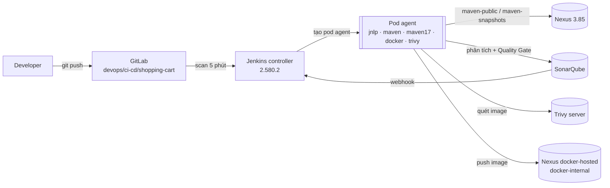

# Tài liệu CI: pipeline Maven `shopping-cart` trên EKS

Tài liệu mô tả phần **CI** (build → kiểm tra chất lượng → quét bảo mật → lưu artifact) của ứng dụng `shopping-cart`, chạy bằng Jenkins trên cụm EKS `eks-cluster-ver1`. Phần CD (GitOps + Argo CD) đang tạm dừng, xem [mục 9](#9-gitops--cd-đang-tạm-dừng).

- Mã nguồn app: GitLab `devops/ci-cd/shopping-cart` (bản sao trên GitHub `quangchuhong/ci-cd-maven-java-ver1`)
- Pipeline: [`Jenkinsfile`](../Jenkinsfile)
- Hạ tầng (Terraform, Helm): [`quangchuhong/terraform-eks-devops-tools`](https://github.com/quangchuhong/terraform-eks-devops-tools)

---

## 1. Kiến trúc



Mọi thành phần chạy trong cụm EKS và **dùng chung một ALB** (Ingress group `alb-apps`, HTTP 80). Pipeline gọi các dịch vụ qua **địa chỉ trong cụm** (`*.svc.cluster.local`), không đi qua ALB. Riêng docker registry dùng tên `docker-internal.gitlabonlinecom.click`, vì đó cũng là tên của image.

| Dịch vụ | Giao diện web | Pipeline gọi tới |
|---|---|---|
| GitLab | http://gitlab.gitlabonlinecom.click | `http://gitlab.gitlabonlinecom.click/devops/ci-cd/shopping-cart.git` |
| Jenkins | http://jenkins.gitlabonlinecom.click | — |
| Nexus | http://nexus.gitlabonlinecom.click | `http://nexus.nexus.svc.cluster.local:8081` |
| Nexus docker (push) | — | `docker-internal.gitlabonlinecom.click` (repo `docker-hosted`, cổng 8000) |
| SonarQube | http://sonarqube.gitlabonlinecom.click | `http://sonarqube-sonarqube.sonarqube.svc.cluster.local:9000` |
| Trivy server | — (không mở Ingress, server không có xác thực) | `http://trivy.trivy.svc.cluster.local:9090` |

## 2. Các stage

| # | Stage | Container | Lệnh chính | Fail khi |
|---|---|---|---|---|
| 1 | Checkout | jnlp | `checkout scm`; tag image = `git rev-parse --short HEAD`; version = `version` trong `pom.xml` | Không clone được repo |
| 2 | Build & Unit Test | `maven` (JDK 8) | `mvn clean verify`: compile, test, package, JaCoCo; publish JUnit | Lỗi compile, test fail |
| 3 | SonarQube Analysis | `maven17` (JDK 17) | `sonar-maven-plugin 5.1` với `sonar.projectVersion=<pom version>` và coverage JaCoCo | Scanner lỗi |
| 4 | Quality Gate | — | `waitForQualityGate` (chờ webhook từ SonarQube, tối đa 5 phút) | Gate khác `OK` |
| 5 | Publish Jar to Nexus | `maven` | `mvn deploy -DskipTests` lên `maven-snapshots` (hoặc `maven-releases`) | Không có quyền deploy |
| 6 | Docker Build | `docker` (dind) | `docker build`, `docker save` thành file tar trong workspace | Build image lỗi |
| 7 | Trivy Scan Image | `trivy` | Quét file tar qua Trivy server, lưu `trivy-report.json` và `trivy-report.txt` | Có HIGH/CRITICAL **khi** `TRIVY_EXIT_CODE = '1'` |
| 8 | Push Image to Nexus | `docker` | `docker push docker-internal.gitlabonlinecom.click/dev-backend/shopping-cart:<git-sha>` | Không có quyền push |
| 9 | Update GitOps | `maven` | Bỏ qua khi `GITOPS_ENABLED = false` | — |

Image chỉ được push **sau khi** qua Quality Gate và Trivy, nên registry chỉ chứa image đã qua kiểm tra.

Các container trong pod dùng **chung workspace**. Vì vậy Trivy quét thẳng file tar mà container `docker` vừa tạo, không cần đẩy qua registry hay Nexus raw.

## 3. Pod agent

Mỗi build tạo một pod riêng trong namespace `jenkins`. Pod bị xoá khi build xong, không giữ trạng thái giữa các build.

| Container | Image | Vì sao |
|---|---|---|
| `jnlp` | `jenkins/inbound-agent:3355.v388858a_47b_33-3-jdk21` | Kết nối về controller. **Phải là JDK 21**, cùng Java với Jenkins 2.580; agent JDK 17 sẽ lỗi `UnsupportedClassVersionError` |
| `maven` | `maven:3.9.9-eclipse-temurin-8` | App là Spring Boot 1.5, chỉ chạy được trên Java 8 (JDK 11+ đã bỏ `javax.xml.bind`) |
| `maven17` | `maven:3.9.9-eclipse-temurin-17` | SonarQube 2025.x yêu cầu scanner chạy trên Java 17+ |
| `docker` | `docker:24-dind` (privileged) | Build và push image; khai báo `--insecure-registry` vì registry đang chạy HTTP |
| `trivy` | `aquasec/trivy:0.68.2` | Cùng phiên bản với Trivy server |

Maven dùng file `.ci-settings.xml` sinh ra lúc chạy, **không chứa mật khẩu**: mật khẩu được truyền vào bằng biến `${env.NX_USER}` và `${env.NX_PASS}` từ `withCredentials`. Mọi dependency đều lấy qua Nexus `maven-public` (mirror `*`).

Pipeline đặt `disableConcurrentBuilds()` (mỗi nhánh chỉ chạy một build tại một thời điểm) và chỉ giữ 20 build gần nhất (artifact của 10 build).

## 4. Credentials

Credentials được Jenkins tạo bằng **JCasC** khi khởi động. Giá trị lấy từ Kubernetes Secret trong namespace `jenkins`, không nằm trong git và không đi qua giao diện web.

| Credential ID | Kiểu | Nguồn (Secret `jenkins/…`) | Dùng cho | Tạo bằng |
|---|---|---|---|---|
| `nexus-creds` | Username/password | `nexus-ci` (`username`, `password`) | Maven đọc `maven-public`, deploy jar | `helm-install/nexus/bootstrap.sh` |
| `docker-user-internal` | Username/password | `nexus-ci` | Push image vào `docker-hosted` | `helm-install/nexus/bootstrap.sh` |
| `sonarqube-token` | Secret text | `sonarqube-token` (`token`) | Server SonarQube tên `SonarQube` | `helm-install/sonarqube/bootstrap.sh` |
| `gitlab-token-dev-group` | Username/password | `gitlab-ci` (`username`=`oauth2`, `token`) | Clone repo app, push GitOps repo | `kubectl create secret` (group access token của `devops`) |

User Nexus `ci-jenkins` có role `ci-role`, chỉ có quyền:
- đọc `maven-public` và `docker-group`;
- deploy vào `maven-releases`, `maven-snapshots`, `docker-hosted`.

**Đổi mật khẩu hoặc token:** chạy lại script bootstrap tương ứng (hoặc `kubectl apply` secret mới), rồi `kubectl -n jenkins delete pod jenkins-0` để JCasC nạp lại.

## 5. SonarQube Quality Gate

- Quality profile `Sonar way` (Java, XML); Quality Gate `Sonar way`.
- **Gate chỉ xét New Code** (*Clean as You Code*):

  | Điều kiện trên New Code | Ngưỡng |
  |---|---|
  | Issue mới | 0 |
  | Security Hotspot đã review | 100% |
  | Coverage | ≥ 80% |
  | Code trùng lặp | ≤ 3% |

- **New Code** = mọi thay đổi kể từ lần đổi `version` trong `pom.xml` (`sonar.projectVersion` lấy từ pom, **không** dùng mã commit).
- SonarQube cần lịch sử Git để biết dòng nào là code mới. Workspace do container `jnlp` checkout, còn scanner chạy bằng root trong `maven17`, nên pipeline phải chạy `git config --global --add safe.directory "$WORKSPACE"` trước khi quét. Log đúng sẽ có dòng `SCM Publisher SCM provider for this project is: git`.
- **Security Hotspot luôn cần người review** trên SonarQube (tab *Security Hotspots → New Code*, đánh dấu *Safe*/*Fixed* kèm lý do). Gate fail cho đến khi review xong.
- Webhook `jenkins` trong SonarQube → `http://jenkins.jenkins.svc.cluster.local:8080/sonarqube-webhook/`. Thiếu webhook này thì stage Quality Gate sẽ chờ đến hết timeout.

Kết quả lần chạy gần nhất (commit `59e6773`): **Passed**: 0 issue mới, Hotspots Reviewed 100%, Coverage 91.7%, Duplications 0%.

## 6. Trivy

- Client trong pod gửi dữ liệu image tới Trivy server; server giữ vulnerability DB. Client vẫn tải **Java DB** để nhận diện thư viện trong file jar (khoảng 3–4 GB ổ đĩa tạm).
- Chỉ quét lỗ hổng (`--scanners vuln`), không quét secret hay cấu hình.
- Báo cáo đầy đủ được lưu thành artifact của build: `trivy-report.json` và `trivy-report.txt` (trang build → *Build Artifacts*).
- `TRIVY_EXIT_CODE = '0'`: chỉ báo cáo, không chặn pipeline. Spring Boot 1.5.3 (2017) có nhiều CVE HIGH/CRITICAL; sau khi nâng cấp (Spring Boot 3, Java 17) thì đổi thành `'1'` để chặn image có lỗ hổng.

## 7. Artifact

| Loại | Nơi lưu | Tên |
|---|---|---|
| Jar | Nexus `maven-snapshots` | `com.reljicd:shopping-cart:0.0.1-SNAPSHOT` (mỗi lần deploy có timestamp riêng) |
| Image | Nexus `docker-hosted` | `docker-internal.gitlabonlinecom.click/dev-backend/shopping-cart:<git-sha-7>` |
| Báo cáo test | Jenkins (JUnit) | Tab *Tests* của build |
| Báo cáo Trivy | Jenkins artifact | `trivy-report.json`, `trivy-report.txt` |
| Phân tích chất lượng | SonarQube | Project `shopping-cart` |

Kiểm tra image trên Nexus: *Browse → docker-hosted → dev-backend/shopping-cart*.

## 8. Nhánh

| Nhánh app | Môi trường (khi bật CD) | Ghi chú |
|---|---|---|
| `develop` | test | Sau đó có bước duyệt promote lên staging |
| `release/*` | staging | |
| `main` | prod | |

Job Jenkins là **Multibranch Pipeline** `shopping-cart`: nguồn Git `http://gitlab.gitlabonlinecom.click/devops/ci-cd/shopping-cart.git`, credential `gitlab-token-dev-group`, quét lại repo 5 phút một lần. Nhánh nào có `Jenkinsfile` thì tự có job riêng.

## 9. GitOps / CD (đang tạm dừng)

`GITOPS_ENABLED = false` trong Jenkinsfile: stage *Update GitOps* chỉ in thông báo rồi bỏ qua, và các bước promote/rollback staging không chạy. Pipeline vẫn kết thúc **SUCCESS** khi image đã lên Nexus.

Để bật CD cần:
1. Nội dung GitOps repo `devops/ci-cd/gitops-shopping-cart`: Helm chart, `test/`, `staging/`, `prod/` (`values.yaml` có khoá `image.repository` và `image.tag`); các nhánh `develop`, `staging`, `main`.
2. Cài Argo CD (`helm-install/argocd` trong repo hạ tầng).
3. Cho node EKS pull được image từ registry HTTP: hoặc bật HTTPS cho ALB bằng ACM (khuyến nghị), hoặc cấu hình containerd chấp nhận registry HTTP.
4. Đổi `GITOPS_REPO_URL` thành `http://gitlab.gitlabonlinecom.click/devops/ci-cd/gitops-shopping-cart.git` và đặt `GITOPS_ENABLED = true`.

## 10. Vận hành

**Chạy build:** push lên GitLab (Jenkins tự quét trong vòng 5 phút), hoặc *shopping-cart → \<nhánh\> → Build Now*.

**Theo dõi:**
```bash
kubectl -n jenkins get pods -w
kubectl -n jenkins logs <pod-agent> -c jnlp --tail=20
```

**Kiểm tra bảo mật Jenkins** (chỉ đọc, không in mật khẩu), trong repo hạ tầng:
```bash
./helm-install/jenkins/security-audit/run.sh
./helm-install/jenkins/security-audit/run.sh plugins.groovy
```

**Thêm một project Maven mới:**
1. Tạo repo trên GitLab trong group `devops` (token `gitlab-ci` đã có quyền), rồi copy `Jenkinsfile` và sửa `APP_NAME`, `SONAR_PROJECT_KEY`.
2. Trong Jenkins tạo *Multibranch Pipeline* trỏ tới repo, credential `gitlab-token-dev-group`.
3. Lần quét SonarQube đầu tiên tự tạo project; gate mặc định là *Sonar way*.
4. Nếu app dùng Java khác, đổi image của container `maven` (ví dụ `maven:3.9.9-eclipse-temurin-17` hoặc `-21`).

## 11. Sự cố đã gặp và cách xử lý

| Triệu chứng | Nguyên nhân | Cách xử lý |
|---|---|---|
| Build đứng ở `‘…’ is offline`, log `jnlp`: `UnsupportedClassVersionError … class file version 65.0` | Agent `jnlp` chạy JDK 17, controller 2.580 cần Java 21 | Dùng `inbound-agent:…-jdk21` |
| Test lỗi `NoClassDefFoundError: javax/xml/bind/JAXBException` | Spring Boot 1.5 chạy trên JDK 11+ | Build và test bằng `maven:…-temurin-8` |
| Pod agent bị **Evicted**: `low on resource: ephemeral-storage` | Ổ gốc node 20 GB; Trivy Java DB khoảng 3,7 GB | Node 100 GB gp3 (`node_disk_size`), Trivy `--scanners vuln` |
| Jenkins, Nexus, Trivy `Pending`: `volume node affinity conflict` | Volume EBS ở AZ `1a` nhưng không còn node nào ở `1a` (Cluster Autoscaler hạ xuống 2 node) | `min_size = 3`: luôn có 1 node mỗi AZ |
| Quality Gate fail dù code mới đã sạch | Không có dữ liệu `git blame` (thiếu `SCM Publisher` trong log), nên SonarQube coi toàn bộ code là mới | `safe.directory` trong stage SonarQube |
| Quality Gate fail: Coverage 66.7% / Hotspots 0% | Code mới chưa có test, hotspot chưa review | Thêm test MockMvc (coverage 91.7%); review hotspot trên SonarQube |
| Quality Gate luôn pass dù code nhiều issue | `sonar.projectVersion` = mã commit, nên New Code chỉ là commit cuối | Lấy version từ `pom.xml` |
| Jenkins `Init:CrashLoopBackOff` khi cài plugin | Phiên bản plugin ghim lệch nhau (`configuration-as-code` cũ hơn bản `git-client` yêu cầu) | Ghim toàn bộ 124 plugin theo một bộ đã kiểm chứng |
| `git push` lên GitLab: `Authentication failed` | Dùng mật khẩu thay cho Personal Access Token, hoặc Keychain lưu thông tin cũ | Xoá Keychain, dùng token `write_repository` |

## 12. Hạn chế và việc tiếp theo

- **Spring Boot 1.5.3 / Java 8 đã hết hỗ trợ**: nhiều CVE, nên Trivy gate chưa bật. Nên nâng lên Spring Boot 3 + Java 17.
- **Registry và các app chạy HTTP**: mật khẩu và token đi dạng plain text qua ALB. Nên bật HTTPS bằng ACM; đây cũng là điều kiện để node pull image khi làm CD.
- **`docker:dind` privileged**: có thể thay bằng BuildKit rootless.
- **Jar luôn là SNAPSHOT**: khi release cần quy trình đổi version (ví dụ `mvn versions:set` trên nhánh `release/*`).
- CD (GitOps + Argo CD): xem mục 9.
